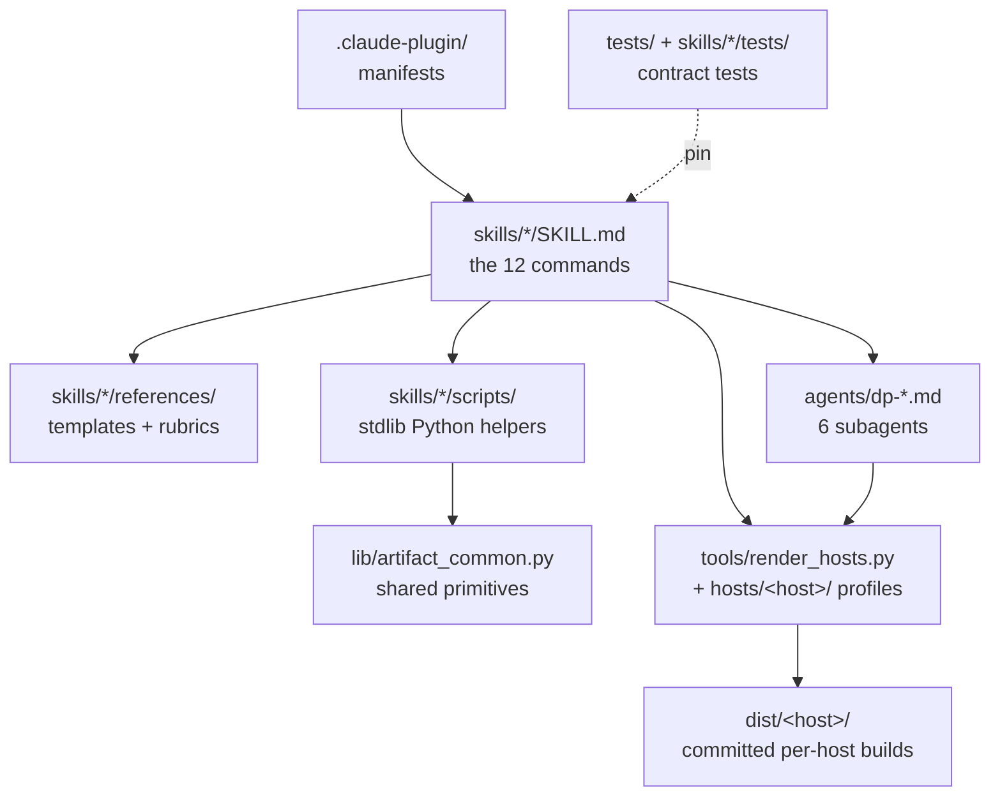

# Development

This repo is a single-plugin marketplace: the repo root is the plugin root. Everything shipped is markdown prompt content plus stdlib-only Python helpers; the only runtime dependencies are the pi build's npm extensions in `package.json`.

## Layout



| Path | Role |
|---|---|
| `skills/<name>/SKILL.md` | One command each. The body is the orchestration prompt; frontmatter is what's always resident. |
| `skills/<name>/references/` | Templates and principles files. Cost nothing until a run reads them. |
| `skills/deep-plan/scripts/` | `setup_session.py` (project state), `finalize_plan.py` (repair/archive/index), `load_tasks.py` (the plan-grammar parser), `resolve_slug.py`. |
| `skills/deep-plan/hooks/cleanup.py` | `SessionEnd` hook: deletes the session sandbox and state file. |
| `skills/product-artifacts/` | Not a command — the shared substrate for the product chain: `scripts/product_artifact.py` (folders, provenance, freshness, the product index) and `references/artifact-family.md` (the chain contract). |
| `skills/product-issues/scripts/` | Six modules for slicing and GitHub filing (`file_issues.py` is the CLI). |
| `agents/` | The six `dp-*` subagent definitions. Only `dp-implement-task` may write; the rest are read-only. |
| `lib/artifact_common.py` | Slug validation and generated-region primitives shared by both pipelines. |
| `tests/`, `skills/*/tests/` | Contract tests; cross-skill ones at the root, the rest co-located with their skill. |
| `hosts/<host>/` | One render profile per non-Claude host (`generic`, `codex`, `pi`): `PROFILE` in `__init__.py` (token rewrites, dropped frontmatter, agent frontmatter mapping, optional `extends`), a `HOST.md` shipped at the build root, and optional `overlays/` that replace whole sections. `hosts/pi/` also holds the vendored pi extensions and their `THIRD_PARTY_LICENSES.md`. |
| `tools/render_hosts.py` | Renders the source into `dist/<host>/`; `--check` reports a stale build without writing. |
| `tools/smoke_pi.sh` | Manual end-to-end check of `dist/pi` in a real pi (see below). |
| `dist/<host>/` | Generated, committed builds. Never hand-edited. |
| `plugin.json`, `.agents/plugins/marketplace.json` | Codex plugin manifest and marketplace; the marketplace entry points at `./dist/codex`. |
| `package.json` | pi package manifest: `pi.skills` and `pi.extensions` point into `dist/pi`, with the npm extensions as dependencies (`undici` pinned to `8.11.2`) and the pi runtime packages, `@earendil-works/pi-agent-core` among them, as peers. |
| `install.sh` | Bash installer for any agent: copies the `dist/generic` skills into a folder it asks for and resolves the plugin-root placeholder to the install path. |
| `docs/plans/` | Gitignored dogfood output from planning this repo with its own plugin. Not documentation. |

## Local development

```
/plugin marketplace add /absolute/path/to/claude-better-plan   # local checkout
```

`SKILL.md` and `references/` edits hot-reload within a session; changes under `agents/` need `/reload-plugins` or a restart.

The CI gate, runnable locally:

```
uvx ruff check lib skills tools hosts
uvx mypy --strict          # scope comes from pyproject.toml
uvx pytest -q              # discovery owned by pyproject testpaths
```

CI pins `pytest>=9,<10` and installs `tiktoken` for the token-budget test.

## Contract tests: behavior, not wording

The tests pin what shipped prose must still *do*, never how it says it. `GUARANTEES` in `tests/guarantees.py` declares each behavior (a heading that must exist, a script flag that must be invoked, an anchor that must appear); the suite asserts them. Rephrasing a sentence never breaks CI — deleting the behavior behind it does.

`BUDGETS` in the same file caps sizes: the always-resident skill listing (per-entry and aggregate), frontmatter description length, and token budgets for the largest prompt files. No assertion hard-codes its own limit, and a budget never justifies dropping a guaranteed behavior. `README.md` and `PLAN.md` are not budgeted — they are never loaded as model context.

Two tests scan `README.md`, `PLAN.md`, and every shipped markdown file: one fails on any `dp-*` agent name the plugin doesn't ship, one on known-false claims about the harness. Keep both files accurate when editing docs.

## Host builds

The source tree (`skills/`, `agents/`, `lib/`, `PLAN.md`) is Claude-native and is what Claude Code installs. Every other host installs a build rendered from it into `dist/<host>/`:

| Build | Installed by | Profile |
|---|---|---|
| `dist/generic` | `install.sh` | `hosts/generic/`: plain phrases ("an ask", "launch dp-X", `<root>`) defined once in its `HOST.md` |
| `dist/codex` | the Codex marketplace | `hosts/codex/`: `extends` generic, then rewrites to Codex's own tools; it has no overlays of its own |
| `dist/pi` | `pi install` | `hosts/pi/`: does not extend generic (a parent's rewrites would run first); runs its own rules, then generic's as a fallback, and adds the vendored extensions |

Edit the source, a profile, or an overlay, never `dist/`. After any change to `skills/`, `agents/`, `lib/`, `PLAN.md`, or `hosts/`, re-render and commit the builds alongside the change:

```
python3 tools/render_hosts.py            # every host
python3 tools/render_hosts.py pi         # one host
python3 tools/render_hosts.py --check    # report stale builds, write nothing
```

`test_build_is_fresh` in `tests/test_host_builds.py` renders each host into a temp dir and fails when the committed build differs, so a source edit without a re-render fails CI. `dist/` is tracked, not gitignored. The build tests also fail when a Claude-only tool name survives a rewrite, so a new Claude-specific passage in the source needs a rule in each profile that meets it (generic's and pi's maps match the same passages).

## Smoke-testing host builds

The vendored pi extensions under `hosts/pi/` are TypeScript, and this repo has no runner for it: pytest pins only their source text. After any change under `hosts/pi/` (and a re-render), run the manual smoke test in a real pi:

```
bash tools/smoke_pi.sh                                  # model from your pi settings
SMOKE_MODEL=<provider>/<model> bash tools/smoke_pi.sh  # or name one
```

It installs the `dist/pi` build into a throwaway pi agent dir and checks the tool list, the questionnaire's no-UI fallback, `dp-*` agent discovery, `web_search` in a child agent, and session-end cleanup, printing PASS or FAIL for each. It needs `pi` and `npm` on PATH and a configured model provider, and spends a few model calls. Each pi run is cut off after `SMOKE_TIMEOUT` seconds (default 180), so a provider that never answers fails rather than hangs. CI runs only the part that needs no pi: the script must fail when pi is missing.

## Releases

Versions are cut by CI, never by hand. A `feat:` or `fix:` commit on `main` bumps `.claude-plugin/plugin.json` and tags a release (`chore(release): vX.Y.Z [skip ci]`). Two rules follow:

- Never edit the version field manually. The bump writes it to `.claude-plugin/plugin.json`, `plugin.json`, and `package.json` together; a test fails if they drift.
- A change that moves files (a renamed skill, a moved reference) must land as `feat:` or `fix:` — that version bump is what re-keys the installed plugin cache onto the new layout. Documentation-only changes use `docs:` and cut no release.
